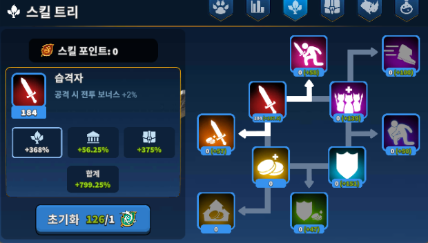

# MLCalculator


MLCalculator는 Million Lords의 공격력, 도시 업그레이드 비용, 예상 모집량, 상위 비율별 등수를 계산하는 도구입니다. Windows와 Android 앱은 오프라인에서 사용할 수 있습니다. 이 저장소에는 모바일 웹 버전과 기존 Python 원본도 있습니다.

## 다운로드

[최신 GitHub 릴리스](https://github.com/taewan192/MLCalculator/releases/latest)에서 파일을 받을 수 있습니다.

| 플랫폼 | 파일 | 사용 방법 |
| --- | --- | --- |
| Windows 1.2.1 | `MLCalculator-1.2.1-Windows.exe` | Windows 10/11 64비트에서 실행합니다. Microsoft Edge WebView2 Runtime이 필요합니다. |
| Android 1.2.2 | `MLCalculator-1.2.2-release.aab` | Google Play Console에 업로드할 앱 번들입니다. 패키지명은 `com.arcana.mlcalculator`, 버전 코드는 `13`입니다. |

## 기능과 사용 방법

| 메뉴 | 계산하거나 설정할 수 있는 항목 |
| --- | --- |
| [플레이어 스텟](#플레이어-스텟) | 총공격력과 도달 가능한 목표 레벨 |
| [도시 계산기](#도시-계산기) | 목표 레벨까지 드는 골드 또는 보유 골드로 도달할 수 있는 도시 레벨 |
| [예상 모집](#예상-모집) | 리그, 장비, 레벨을 반영한 모집 배율과 병력 수 |
| [백분률 계산기](#백분률-계산기) | 상위 100%, 80%, 60%, 50%, 25%, 6%, 1%의 예상 등수 |
| [설정](#설정) | 언어, 화면 테마, 그림이 있는 앱 사용 방법 |

### 플레이어 스텟

**장비 + 레벨 + 병력**은 스킬 포인트를 모두 공격력에 사용했을 때 쓰는 모드입니다.

1. **리그**에서 `다이아 & 레전드` 또는 `플&골&실`을 선택합니다.
2. **장비 공격력 (%)**에는 장비 공격 보너스를 입력합니다. 장비에 `300%`가 표시되면 `300`을 입력합니다.
3. **레벨**에는 플레이어 레벨을, **병력**에는 공격에 보낼 병력과 단위(예: `1G`, `269G`, `1.5P`)를 입력합니다.
4. **계산**을 누르면 총공격력과 공격력 기준표에서 도달 가능한 가장 높은 레벨이 표시됩니다. 총공격력을 이미 알고 있으면 아래의 **공격력 직접 입력**에 넣어 목표 레벨을 조회할 수 있습니다.

총공격력은 `병력 × (100 + 장비 공격력 + 레벨 보너스) ÷ 100`입니다. 병력 `1G`, 장비 공격력 `300%`, 레벨 `105`를 입력하면 다음과 같습니다.

| 리그 | 레벨 보너스 | 예시 총공격력 |
| --- | --- | ---: |
| 다이아 & 레전드 (`Dia & LL`) | `(레벨 - 1) × 4` | 8.16G |
| 플&골&실 (`P,G,S`) | `(레벨 - 1) × 2` | 6.08G |

#### 스킬분할

공격력 외의 스킬에도 포인트를 배분했다면 입력 카드 오른쪽 위의 **스킬분할**을 켭니다. **레벨** 칸이 **공격력 스킬 스텟**으로 바뀌면, 게임의 스킬 트리에서 빨간 검 모양의 공격 스킬을 선택하고 왼쪽 아이콘 바로 아래의 숫자를 입력합니다. 아래 예시에서는 **184**가 공격 스킬에 투자한 포인트이고, `+368%`와 합계 `+799.25%`는 화면에 표시된 보너스입니다.



이 모드는 공격 스킬 **1포인트당 2%**를 적용합니다. 장비 공격력 `171%`, 스킬 포인트 `184`, 병력 `269G`라면 `269G × (171 + 184 × 2 + 100) ÷ 100`으로 계산해 **1.72T**로 표시합니다. 앱 내 가이드에서는 184에 노란 테두리와 화살표가 표시됩니다.

### 도시 계산기

- **목표 레벨 비용**에서 함께 업그레이드할 **도시 수**, **현재 도시 레벨**, **목표 도시 레벨**을 입력합니다. 목표가 현재보다 높아야 계산할 수 있습니다.
- **보유 골드로 업그레이드**에서는 **도시 수**, **현재 도시 레벨**, **보유 골드**를 입력합니다. `100G`라면 숫자 `100`을 넣고 단위로 `G`를 선택하세요. 결과에 예산으로 도달 가능한 레벨, 사용 골드, 남은 골드가 표시됩니다.

두 모드 모두 도달 레벨의 **도시당 성벽**, **도시당 승점**, **총 획득 승점**, **전체 기본 부대 생산량**을 보여줍니다. 부대 생산량은 `도달 레벨의 도시당 승점 × 3 × 도시 수`입니다. 레벨이 서로 다른 도시들은 현재 레벨별로 따로 계산하세요.

필요 골드는 `도시 수 × 50 × (1.2^(도달 레벨 - 1) - 1.2^(현재 레벨 - 1))`이며, 총 획득 승점은 `(도달 레벨의 도시당 승점 - 현재 레벨의 도시당 승점) × 도시 수`입니다.

예를 들어 도시 **1개**를 레벨 **1 → 130**으로 올리려면 약 **819G**가 필요합니다. 앱에는 도시당 성벽 **1.15T**, 도시당 승점 **25.1M**, 총 획득 승점 **25.1M**, 기본 부대 생산량 **75.3M**이 표시됩니다.

### 예상 모집

1. **리그**를 선택합니다.
2. 게임에 표시된 **부대 생산량**을 단위와 함께 입력합니다. 예시는 `3G`입니다.
3. **장비 모집 (%)**에 장비의 모집 보너스를 입력합니다. 보너스가 `360%`라면 `360`을 입력합니다.
4. **레벨**에 플레이어 레벨을 입력하고 **계산**을 누르면 총 모집 배율과 예상 모집량을 확인할 수 있습니다.

앱은 `부대 생산량 × 총 모집 배율 ÷ 100`을 적용합니다. 부대 생산량 `3G`, 장비 모집 `360%`, 레벨 `110`의 예시는 다음과 같습니다.

| 리그 | 총 모집 배율 | 예상 모집량 |
| --- | ---: | ---: |
| 다이아 & 레전드 | `360 + (110 - 1) × 6 = 1,014%` | 30.4G |
| 플&골&실 | `360 + (110 - 1) × 3 = 687%` | 20.6G |

### 백분률 계산기

같은 시점의 순위표에서 **현재 등수**와 **현재 상위 비율 (%)**을 읽어 입력합니다. 등수는 1 이상의 정수이고, 비율은 0보다 크고 100 이하입니다. 상위 `6.25%`라면 `6.25`를 입력할 수 있습니다.

전체 인원은 `현재 등수 ÷ (현재 상위 비율 ÷ 100)`을 가장 가까운 정수로 반올림해 추정합니다. 각 구간의 마지막 등수는 `추정 전체 인원 × 구간 비율 ÷ 100`의 소수점을 버려 계산하며, 최소 1등으로 표시합니다. 게임이 표시한 비율을 반올림했거나 순위가 바뀌면 실제 기준과 차이가 날 수 있습니다.

예를 들어 현재 **250등**, 상위 **6.25%**를 입력하면 전체 인원은 약 **4,000명**이고 다음과 같이 표시됩니다.

| 상위 비율 | 예상 마지막 등수 |
| --- | ---: |
| 100% | 4,000등 |
| 80% | 3,200등 |
| 60% | 2,400등 |
| 50% | 2,000등 |
| 25% | 1,000등 |
| 6% | 240등 |
| 1% | 40등 |

### 설정

- **언어**에서 한국어, 영어, 일본어, 중국어(간체), 힌디어, 필리핀어, 태국어, 베트남어, 러시아어, 인도네시아어(`Bahasa Indonesia`)를 선택할 수 있습니다. 새로 설치했을 때 기본 언어는 영어입니다.
- **화면 스타일**에서 화이트 모드와 다크 모드를 바꿀 수 있습니다. 언어, 테마, 입력값은 기기에 저장됩니다.
- **앱 사용 방법**은 계산기 4개의 입력 위치를 번호가 붙은 그림으로 보여줍니다. 입력 예시와 스킬 트리 사진을 포함하며, 앱에서 선택한 언어로 표시됩니다.

## 소스 구성

| 폴더 | 내용 |
| --- | --- |
| `android/` | Android Gradle 프로젝트와 독립 Vite 프런트엔드 `web/` |
| `windows/` | pywebview 실행기, PyInstaller 빌드 스크립트, 포함된 웹 화면 |
| `website/` | Sites로 배포한 모바일 웹의 React 원본 및 구성 |
| `legacy-python/` | 통합 Tkinter 계산기와 초기 Player Stats Python 원본 |
| `icons/` | 성 아이콘 SVG 및 PNG |

## Windows 빌드

Python 3.12 64비트 가상환경에서 실행합니다.

```powershell
cd windows
python -m venv .venv
.\.venv\Scripts\Activate.ps1
pip install -r requirements.txt
.\build.ps1
```

결과는 `windows/dist/MLCalculator.exe`입니다. 실행 PC에는 Python이 필요 없지만
Windows 10/11 64비트와 Microsoft Edge WebView2 Runtime이 필요합니다.
설정은 `%LOCALAPPDATA%\MLCalculator` 아래에 저장됩니다.
Windows 코드 서명 인증서는 적용하지 않았습니다.

Windows 1.2.1 화면은 `windows/frontend/`의 React 원본을 수정하고
해당 폴더에서 `pnpm build`를 실행한 뒤 EXE를 다시 빌드합니다.

## Android 빌드

JDK 17 또는 21, Android SDK 36, Build Tools 36.0.0이 필요합니다.
`ANDROID_HOME` 또는 로컬 `android/local.properties`로 SDK 경로를 지정합니다.

```powershell
cd android
.\gradlew.bat assembleDebug
```

릴리스 AAB는 로컬 서명키와 `signing.properties`를 준비한 후
`gradlew.bat bundleRelease`로 빌드합니다. 서명키와 비밀번호는 GitHub에 포함하지 않았습니다.
기존 Play 앱 업데이트에는 원래 업로드 서명키를 유지해야 합니다.
패키지명은 `com.arcana.mlcalculator`, 현재 Android 버전은 1.2.2, versionCode는 13입니다.

## 웹 원본

`android/web/`는 독립 Vite 앱이며 `pnpm install`, `pnpm dev`로 개발할 수 있습니다.
`website/`는 기존 Sites 배포 구성의 백업이며, 배포 프로젝트 설정은 원래 환경에 연결되어 있습니다.
이 저장소에 푸시하는 것만으로 기존 사이트가 자동 배포되지는 않습니다.

## 보관 및 검증

서명키, 비밀번호, 로컬 SDK 경로, 사용자 저장값, 의존성 폴더는 제외했습니다.
계산식은 기존 Python과 200개 도시 사례를 비교했고, Windows EXE의 화면 로드,
탭 전환, 도시 계산, 테마 변경과 재실행 시 복원을 확인했습니다.
Android는 빌드·lint·번들 구조 검증을 수행했으며 실기기 검증은 별도로 필요합니다.
